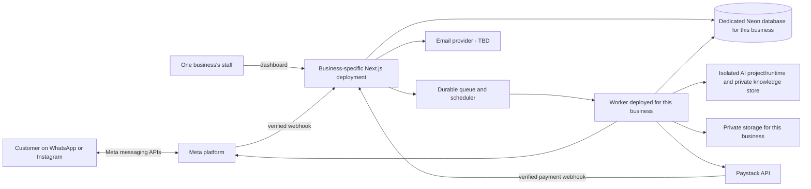
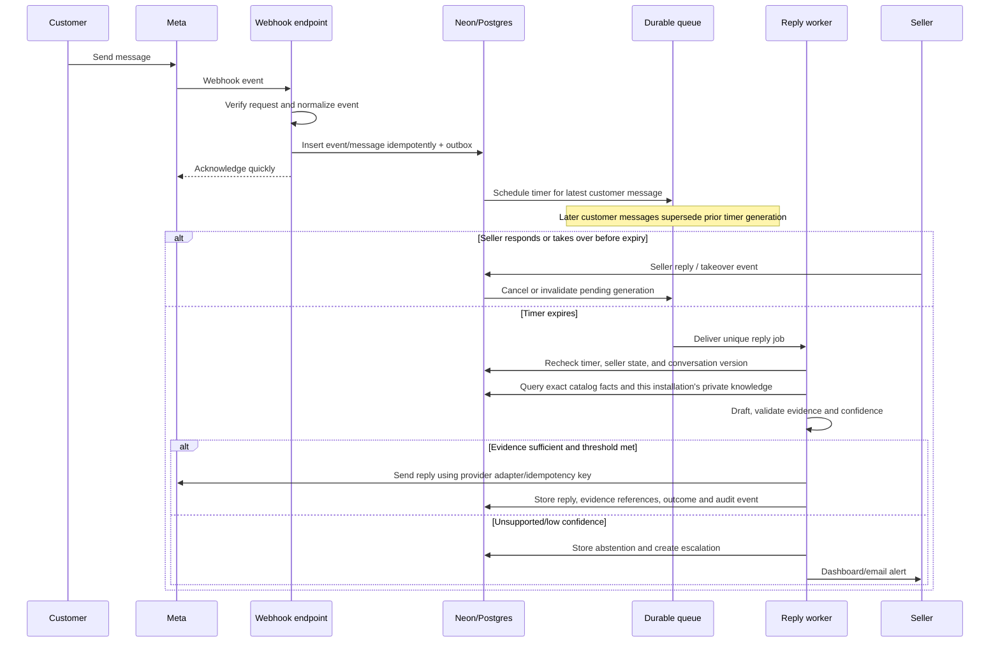

# Sales Assistant — Architecture

**Status:** Proposed architecture for planning; unresolved choices are called out below.  
**Required stack:** Next.js and Neon Postgres  
**Release target:** v2, Nigeria; WhatsApp and Instagram  
**Business model:** Monthly fee per business; price/resource tier TBD  
**Last updated:** 2026-11-13

## 1. Architecture goals

- Treat one deployment as one business system. A separate deployment created from the same source serves each additional business.
- Give each deployment its own app configuration, database, AI resources, credentials, and business data; no cross-business database or AI routing exists.
- Prevent unsupported AI claims and prevent automation from overriding seller decisions.
- Accept Meta and Paystack webhook retries without duplicate messages, orders, or payment state changes.
- Keep the 60-second delay and other async work durable across application restarts and deployments.
- Make provider, model, and hosting choices replaceable behind narrow interfaces.
- Preserve enough evidence and audit history for sellers and operators to understand each action.

## 2. Proposed system context



The browser talks only to authenticated endpoints in the business’s deployment. Provider secrets, retrieval, authorization, order calculations, payment initialization, and AI prompts stay server-side. Long-running work does not run inside a customer-facing request. Each deployment is configured for exactly one business and uses only that business’s database, AI project/runtime, knowledge store, private file storage, and credentials. The same source code can be installed again with separate configuration and resources for another business. There is no shared application control plane, tenant resolver, or cross-business data path. AI vendor-managed model compute may be shared underneath isolated projects/runtimes; the business isolation boundary is the per-business deployment, resources, credentials, and context.

## 3. Proposed runtime boundaries

### Web application

Next.js provides the dashboard and server endpoints for user actions, Meta OAuth/connection callbacks, webhooks, and Paystack return flows. Server actions or route handlers may be used, but they must call the same authorization and domain services. Business rules do not live in React components.

### Domain/application services

Framework-independent application services own use cases such as `ConfigureBusiness`, `ConnectChannel`, `ImportCatalog`, `HandleInboundMessage`, `PrepareReply`, `TakeOverConversation`, `CreateOrderDraft`, `ApproveOrder`, `CreatePaymentLink`, and `ApplyPaymentEvent`. The deployment has one business configuration; services enforce that deployment’s staff roles and record audit/outbox entries in its database. They do not resolve tenant databases or AI resources dynamically.

### Background worker

A worker deployed for the same single business consumes durable jobs for response timers, retrieval and reply generation, provider sends, email alerts, document processing/embedding, payment reconciliation, and cleanup/export tasks. The queue/scheduler vendor is not chosen. That business database’s transactional outbox is the source for enqueuing domain events so a database commit cannot be separated from its scheduled work. The worker only receives credentials for its own installation.

### Provider adapters

Adapters isolate Meta WhatsApp, Meta Instagram, Paystack, the AI provider, email, file storage, and the queue. Provider event payloads are validated and normalized into internal types before domain logic sees them. Provider IDs and raw payload references are retained for idempotency and troubleshooting, with secrets and unnecessary PII excluded from logs.

## 4. Proposed repository structure

This is a proposed TypeScript application template. Each installation deploys the same application and worker source with that business’s own environment configuration and resources. TypeScript and workspace tooling are recommendations, not user-selected constraints; confirm during setup.

```text
sales-assistant/
├─ apps/
│  ├─ web/                         # Next.js dashboard, auth pages, API/webhook routes
│  │  ├─ app/
│  │  │  ├─ (auth)/                # Sign in, registration, verification, reset
│  │  │  ├─ (dashboard)/           # Workspace dashboard routes
│  │  │  └─ api/
│  │  │     ├─ webhooks/meta/      # Meta webhook verification and intake
│  │  │     ├─ webhooks/paystack/  # Paystack webhook intake
│  │  │     └─ integrations/       # OAuth/callback endpoints
│  │  ├─ components/
│  │  └─ middleware.ts             # Session and coarse route protection only
│  └─ worker/                      # Durable background job process
├─ packages/
│  ├─ domain/                      # Entities, invariants, domain events, value objects
│  ├─ application/                 # Use cases and authorization policies
│  ├─ db/                          # This business's Neon connection, schema, migrations, repositories
│  ├─ integrations/
│  │  ├─ meta-whatsapp/
│  │  ├─ meta-instagram/
│  │  ├─ paystack/
│  │  ├─ ai/                        # Provider-neutral adapter configured for this business's AI project
│  │  ├─ email/
│  │  ├─ object-storage/
│  │  └─ queue/
│  ├─ retrieval/                   # Exact queries, private RAG indexing and source references
│  ├─ security/                    # Staff role policies, deployment checks, encryption helpers
│  ├─ observability/               # Logging, metrics, tracing and correlation IDs
│  ├─ validation/                  # Shared schemas and provider payload validation
│  └─ ui/                          # Shared accessible dashboard components
├─ docs/
│  ├─ runbooks/
│  ├─ decisions/                   # ADRs for unresolved stack/provider choices
│  └─ threat-model.md
├─ scripts/                        # Local setup, seed data, import/reconciliation helpers
├─ deployment/                     # Per-business setup, environment template, migration and backup runbooks
├─ tests/
│  ├─ integration/
│  ├─ e2e/
│  ├─ security/
│  └─ load/
├─ .env.example
├─ package.json
└─ ...                             # Lockfile and TypeScript/tooling config
```

### First implementation slice

The current scaffold keeps this first vertical slice inside `apps/web`: Meta's webhook route is `src/app/api/webhooks/meta/route.ts`, webhook normalization and Neon persistence are under `src/lib/integrations/meta/`, the Drizzle ORM client and typed schema are in `src/lib/db/`, Drizzle Kit configuration and migration snapshots are in `drizzle.config.ts` and `drizzle/`, and `npm run db:migrate` applies migrations and seeds the single-business defaults. The Neon serverless driver uses Drizzle's HTTP adapter from Next.js route handlers. The historical SQL bootstrap is retained in `db/migrations/` for databases that predate the Drizzle baseline. The proposed separate worker and shared packages remain future work; the webhook writes durable `reply_due` outbox entries but nothing consumes them yet.

The worker may share packages with the web application but runs as part of the same business deployment and scales independently from the web process. If the selected host cannot run a persistent worker, use a managed durable job/scheduler service rather than relying on in-memory timers or request lifetime. The deployment setup for a new business creates its dedicated Neon database and AI project/runtime, establishes credentials and private storage, applies migrations, runs health checks, and only then marks that installation ready. Repeating setup for a second business creates a fully separate deployment and resource set.

## 5. Data model for one business installation

Each deployment has one dedicated database for one business. It contains the business profile/settings, user identities or auth references, staff memberships/roles, channel connections, products, conversations, messages, knowledge metadata/chunks, orders, payment attempts/events, alerts, audit records, and local subscription/status metadata if needed. There is no global control-plane database and no database router. Another business has a separate deployment, database, AI resources, credentials, and backup lifecycle.

The deployment’s single business ID can be stored on records for auditability, but it does not function as a tenant selector. Staff permissions are enforced within that installation. Connection strings and AI credentials come only from that deployment’s managed secrets, never from browser input.

| Entity | Key fields/relationships |
| --- | --- |
| `business` | This installation’s name, locale/currency, timezone, and retention policy. Initial locale/currency assumed `en-NG`/NGN; confirm. |
| `users` | Auth identity or auth-provider reference, verified email, account status. |
| `memberships` | User, role, invitation/status for this one business; unique per user. |
| `business_settings` | Response delay, confidence threshold, retention, and agent settings. |
| `channels` | Business, channel type, provider account IDs, encrypted credential references, connection/eligibility status, capabilities. |
| `products` | Business, title, description, status, base price/currency, freshness metadata. |
| `variants` | Product, seller-defined option values (e.g. size/color), SKU, price override, stock and freshness. Flexible attributes should be validated rather than interpreted as arbitrary facts. |
| `knowledge_sources` | Business, type, original filename/source, processing status, checksum, access-controlled object reference. |
| `knowledge_chunks` | Business/source, text, embedding, metadata/page reference; retrieval filter always includes business. Embedding implementation and Neon extension support must be verified. |
| `customers` | Business, channel-scoped external identity, optional contact details; unique by business/channel/external ID. |
| `conversations` | Business, customer, channel, takeover/paused state, last customer/seller message, current timer/job generation. |
| `messages` | Conversation, provider message ID, sender/type, body or protected media reference, timestamps/status; unique provider event/message key. |
| `orders` / `order_items` | Business, conversation/customer, status, requested details, item/variant snapshots, quantity, price/currency, delivery fields, reviewer and timestamps. |
| `payment_attempts` | Order, provider, unique reference, amount/currency, checkout URL, status, provider transaction ID and verification state. |
| `provider_events` | Provider, event ID or idempotency hash, signature-verification result, received/processed timestamps and safe payload reference. |
| `jobs` / `outbox_events` | Durable event type, business, aggregate ID, scheduled time, attempt count, state, dedupe key, last error category. Implementation may be owned by selected queue tooling. |
| `alerts` | Business, recipient, category, entity reference, delivery state, timestamps. |
| `audit_events` | Business, actor/system identity, action, target, outcome, timestamp, request/correlation ID. Append-only to normal application users. |
| `subscriptions` | This business’s plan/status, period, external billing ID, assigned resource tier, and billing history references if billing is managed in-app. Billing provider and lifecycle TBD. |

Use integer minor units for money (for NGN, kobo) plus an ISO currency code. Snapshot product title, selected variant, unit price, quantity, and address on an order so later catalog edits do not rewrite purchase history. Never store full payment card data. Keep this installation’s resource credentials in a managed secret store; do not store raw database URLs or AI keys in source control.

## 6. Message and reply lifecycle



Each timer is tied to a conversation version or `last_customer_message_at`; stale timer jobs re-read state and exit without sending. Before provider send, the worker rechecks takeover state and whether any later seller response exists. A send attempt and its provider ID are stored so retries can reconcile instead of sending duplicates.

## 7. Retrieval and AI safety

1. Classify the request into a limited intent/action set.
2. For price, variant, stock, hours if structured, order, and payment facts, call typed server-side tools that query current rows. Never use a similar passage as a substitute.
3. For policies, FAQs, and descriptive product copy, retrieve passages only from this installation’s business records and approved/current sources.
4. Build a draft with bounded context. Treat customer messages and uploaded text as untrusted input; retrieved text cannot grant tools or permissions.
5. Validate answer claims against retrieved fact identifiers and apply business confidence threshold and allowed-action policy.
6. If evidence is missing, stale, conflicting, or below threshold, abstain and alert. Preserve evidence references with the message for dashboard review.

The AI provider is TBD. Provider selection must assess English and Nigerian Pidgin quality, data use/retention terms, regional availability, latency, structured tool calling, cost per conversation, and fallback behavior. Never send payment credentials or channel tokens to the model.

## 8. Orders and Paystack

Suggested order state machine:

```text
collecting -> pending_approval -> rejected
                           \-> approved_pending_payment -> paid
                           \-> approved_manual_payment -> seller_verified_paid
```

Canceled, expired, refunded, and disputed states should be designed before release if those cases are supported. State transitions must be explicit domain commands with actor and audit record.

Payment initialization happens server-side after seller approval and customer intent to pay online. The application calculates amount from the approved order snapshot, creates a unique reference, and associates it to the workspace/order. A success redirect is informational only; verified Paystack webhook/event and transaction details determine payment status. Validate signature on raw request bytes, timestamp/replay protections where provided, reference, amount, currency, seller/business mapping, and expected order state. Process events idempotently and alert on mismatch. A verified event transitions the order to paid and allows the customer confirmation.

**Paystack model to validate:** current Paystack documentation describes API keys scoped to an integration and subaccounts/split settlement. The selected product model is a Sales Assistant Paystack integration with seller subaccounts. Confirm platform eligibility, seller identity/KYC requirements, settlement behavior, fees, reversals, and whether seller connection/consent can be handled compliantly before implementation. Avoid collecting a seller’s Paystack secret key.

## 9. Security and privacy boundaries

- Authenticate users and authorize every operation against a staff membership and role for the one business served by this installation.
- Use repositories bound to this deployment’s database; test role enforcement and ensure database/AI credentials cannot be overridden through user input.
- Store provider credentials encrypted through a managed secrets/KMS approach; keep encryption keys out of the database.
- Verify Meta and Paystack webhook authenticity, reject replays where supported, cap payload sizes, and persist only needed data.
- Sanitize and scan uploaded files, restrict MIME/types/size, store privately, and process outside request handlers.
- Apply CSRF protections to browser mutations, rate-limit auth/webhook-adjacent operations, and secure cookies/session rotation.
- Keep customer PII out of logs, prompts unless necessary, and analytics events. Define data deletion cascades and financial/audit retention exceptions.
- Model prompt injection, malicious catalog/document input, excessive tool use, account takeover, SSRF through uploads/URLs, webhook spoofing, and duplicate payment events in the threat model.

## 10. Async work, failure handling, and consistency

| Work | Trigger | Retry/idempotency | Failure behavior |
| --- | --- | --- | --- |
| Inbound webhook | Meta callback | Unique provider event/message key; durable insert before 2xx | Alert/monitor; safely replay unprocessed event. |
| Delayed reply | Latest inbound customer message | Conversation generation key; recheck current state on execution | Stale jobs exit; send failure is retried/reconciled and visible to seller. |
| AI draft/retrieval | Reply timer or seller action | Job key by conversation version; bounded retry | Abstain and alert if provider unavailable beyond retry policy. |
| Outbound message | Approved draft/send command | Provider idempotency if available; persist send attempt before retry | Reconcile provider state to avoid duplicate messages. |
| Catalog import/embeddings | Upload/import completion | Source checksum and row upsert keys | Show row-level errors; keep last valid catalog intact. |
| Paystack event | Payment webhook | Provider event ID/reference plus unique payment transition | Verify, dedupe, reconcile; alert on mismatch. |
| Email alert | Domain alert event | Unique alert/delivery key | Retry with backoff; dashboard alert remains source of truth. |

The deployment database is the source of truth for its business’s product, order, payment, conversation-control, staff membership, and audit state. Provider delivery status is synchronized asynchronously and must not overwrite business approval/payment state.

## 11. Deployment and environments

Required environments are local, test/CI, staging, and production. Each deployed business installation has its own database, AI project/runtime, storage namespace, worker, and secret references. Meta app/configuration, Paystack test/live keys, and webhook endpoints are isolated by environment. No production secret or customer data belongs in local/test environments. Deploying for another business means repeating setup with a new deployment and entirely separate credentials/resources.

Hosting provider, data region, worker runtime, queue, object storage, auth provider, email service, and monitoring vendor are undecided. Choose services that support durable scheduling, private object storage, managed secrets, repeatable setup/backup/restore for each independent deployment, webhook ingress, and isolated AI resources. Confirm Neon project/database setup and operational costs per installation; confirm selected Next.js and Node.js stable versions and deployment/runtime compatibility before lockfile creation.

Release flow: reviewed change -> CI quality/security gates -> staging deploy -> migration and webhook/payment/channel smoke tests -> backup/restore and rollback readiness -> production deploy with monitored health checks. Database migrations must be backward-compatible across rolling releases or use an expand/migrate/contract process.

## 12. Observability and operator controls

- Correlation ID follows webhook event, job, conversation, provider send, and payment reference.
- Metrics: webhook acknowledgement latency/failure, queue lag/depth, job retries/dead letters, reply latency, AI latency/cost/error, message send failures/duplicates, escalations, payment verification mismatch, and database saturation.
- Dashboards: product response/approval metrics and operational integration health are separated by access level.
- Alerts: queue lag, provider outage, rising send failures, webhook signature failures, failed payment reconciliation, backup failures, and unusual unauthorized access attempts.
- Runbooks cover Meta/Paystack outages, credential rotation, stuck/dead-letter jobs, webhook replay, duplicate prevention, failed imports, restore, and rollback.
- Audit log stores seller decisions and agent actions, including reply evidence references and policy outcome.

## 13. Open architecture decisions (ADRs required)

1. Next.js/Node.js exact supported stable versions and package/workspace tooling.
2. Per-business setup and deployment process: operator versus automated provisioning, hosting ownership, repeatable configuration, update/migration rollout, backup/restore, and offboarding.
3. Auth/session provider and invitation/email verification implementation within one business installation.
4. Durable queue/scheduler and worker hosting compatible with 60-second timers and retries.
5. AI resource isolation level: separate project/API credentials and runtime versus dedicated model deployment/compute; embedding model, vector store, and evaluation criteria.
6. Private object storage and document scanning/processing pipeline for each installation.
7. Hosting provider, region, database compute/branching/backup configuration, and network controls.
8. Meta onboarding flow and verified seller-reply detection per WhatsApp/Instagram account type. This is a release gate.
9. Paystack seller subaccount onboarding, consent/KYC, fees and direct settlement details.
10. Email, monitoring, error reporting, and analytics services.
11. Monthly billing provider and whether billing is integrated or handled as an external service per business.
12. Data retention defaults, legal hold/audit exceptions, and WCAG target.

## 14. Key references to validate during implementation

- [WhatsApp Business Developer Hub](https://whatsappbusiness.com/developers/developer-hub/) for direct integration, webhooks, API reference, rate limits, pricing, and current setup.
- [Meta Instagram API documentation](https://www.postman.com/meta/instagram/documentation/6yqw8pt/instagram-api?entity=request-23987686-a71fb850-457c-4b82-a56a-1dea1785f2a2) for current professional-account messaging permissions and behavior.
- [Paystack authentication](https://paystack.com/docs/api/authentication/), [Subaccounts API](https://paystack.com/docs/api/subaccount/), and [webhook guidance](https://paystack.com/docs/payments/webhooks/) for API credentials, settlement, and event verification.

Provider documentation and eligibility can change; revalidate exact APIs and permissions before release rather than treating this architecture note as approval from Meta or Paystack.
